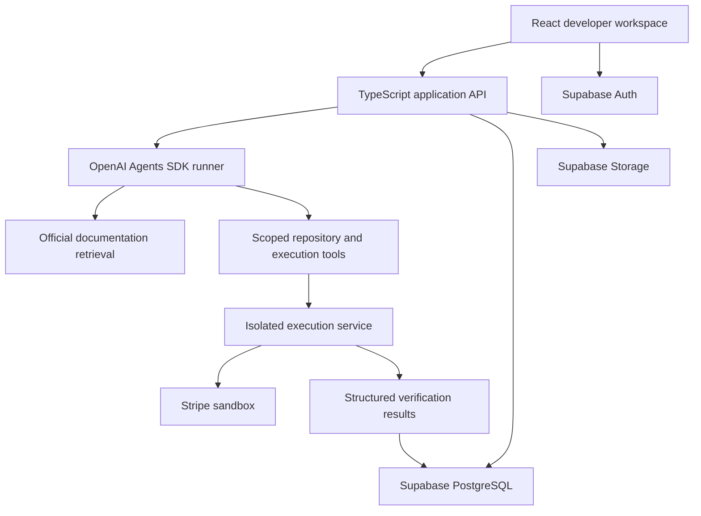

# Merchant Integration Copilot

A developer assistant that inspects a merchant application, proposes a payment integration, produces reviewable changes, and verifies them against an isolated provider sandbox.

**Status: project proposal.** This repository currently contains a build brief. The application, integrations, and tests described below are planned; no implementation or measured results are included yet.

## The problem

Payment integration involves more than generating an API call. Developers must choose the correct flow, preserve request integrity, handle asynchronous events, avoid duplicate effects, and understand which behavior has actually been verified.

This product gives a merchant developer a concrete patch and an evidence-backed test report, including unresolved decisions and integration limits.

### Example

A TypeScript checkout application rejects valid webhook signatures because middleware transforms the request body before verification. The copilot inspects the routing and middleware, retrieves the relevant provider documentation, proposes a minimal patch, and demonstrates that valid requests pass while tampered requests fail.

## Who it serves

- Merchant developers implementing their first payment integration.
- Implementation engineers supporting several merchant applications.
- Teams reviewing changes to existing checkout and webhook code.

## MVP scope

- One provider: Stripe in a sandbox environment.
- One application stack: Node.js, TypeScript, and Express.
- Uploaded source snapshots from small, supported sample repositories.
- Three supported tasks: create a payment, handle its result, and verify/process webhook events.
- A proposed implementation plan, unified diff, and downloadable patch.
- Test execution in an isolated environment and a sandbox verification report.
- A web workspace for reviewing changed files, test output, and unresolved questions.

The first release does not connect to live payment accounts, merge code, deploy merchant applications, support arbitrary frameworks, or require GitHub account access. A later milestone can add a narrowly scoped GitHub integration that creates reviewable pull requests.

## Main workflow

1. A developer creates a project and uploads a source snapshot.
2. The application validates the archive and records its content digest.
3. The agent inspects the project structure, dependency versions, routes, and existing payment behavior.
4. It asks only the questions needed to choose the supported payment flow.
5. Documentation tools retrieve relevant official material and record source URLs and retrieval dates.
6. The agent proposes a plan and generates a patch in an isolated workspace.
7. The execution service runs permitted checks and integration tests.
8. Provider-sandbox tests verify the relevant behavior.
9. The user receives the diff, evidence, limitations, and a patch tied to the original source digest.

## Agent design

Use the **OpenAI Agents SDK** with a single integration agent initially. Keep repository inspection, documentation lookup, patching, and test execution as explicit tools.

Suggested tools:

- `list_project_files` and `read_project_file`: inspect the accepted source snapshot.
- `search_project`: find relevant symbols, routes, and configuration.
- `lookup_provider_docs`: retrieve official documentation with source metadata.
- `get_supported_integration_contract`: inspect the application's supported task and API-version contract.
- `propose_patch`: produce changes against the current workspace version.
- `run_project_checks`: run bounded, configured checks inside the execution environment.
- `run_sandbox_scenarios`: run predefined provider-sandbox scenarios.
- `get_verification_results`: retrieve structured results and artifacts.

The SDK handles the model/tool loop and trace capture. The application owns the execution environment, tool authorization, credentials, source versions, and verification gates.

Add a specialist or handoff only when the task split is useful and evaluation supports it. More agents are not an acceptance criterion.

Repository files, comments, test output, and retrieved documents are task data. Instructions embedded in those sources must not override the user's task or execution permissions.

## Execution boundaries

- Run each project in an ephemeral, unprivileged container or equivalent isolated execution environment.
- Do not mount host directories, host credentials, or a host container-engine socket.
- Validate uploaded archives against path traversal, unexpected symlinks, and size limits before extraction.
- Bound CPU, memory, disk, execution time, model calls, and total attempts per task.
- Restrict network access to the configured package sources, documentation sources, and sandbox endpoints required for the task.
- Keep provider credentials in a controlled execution service or adapter; never include them in model prompts, generated patches, browser state, or downloadable artifacts.
- Treat dependency installation and test scripts as code execution inside the same boundary.
- Provide cancellation and cleanup for every run.

Select and validate the isolation approach before exposing source upload or execution to external users. The README does not claim that a particular sandbox implementation already exists.

## Proposed architecture

- **Frontend:** React and TypeScript for source review, diffs, questions, run progress, and test reports.
- **Application:** a TypeScript API and background agent runner using the OpenAI Agents SDK.
- **Execution:** a separate service that provisions, limits, observes, and cleans up isolated workspaces.
- **Supabase Auth:** developer identity and organization membership.
- **Supabase PostgreSQL:** project metadata, source digests, tasks, run state, decisions, and test results.
- **Supabase Storage:** private source archives, patches, and sanitized report artifacts.
- **Supabase Realtime:** run progress and new verification results.

## Data and authorization

Core entities: `organizations`, `memberships`, `projects`, `source_snapshots`, `integration_tasks`, `task_decisions`, `agent_runs`, `documentation_references`, `patch_versions`, `execution_jobs`, `test_results`, `artifacts`, and `audit_events`.

All project and artifact access is organization-scoped. Apply Row Level Security to permitted client reads and explicit authorization to backend and execution-service paths. Privileged database access must not substitute for tenant checks.

Each patch records the source digest, task requirements, documentation references, dependency/API versions used for verification, changed files, and test-run identifiers. If the source snapshot changes, the patch must be regenerated or explicitly rebased and reverified.

## Verification contract

The copilot must distinguish:

- **Generated:** code was produced but has not been executed.
- **Locally checked:** the stated build or local checks passed.
- **Sandbox verified:** the named provider scenarios ran successfully against a sandbox.
- **Blocked:** a missing prerequisite or failed check prevents a stronger claim.

Report these as separate evidence dimensions where appropriate. A passing build does not imply provider compatibility, and a successful sandbox scenario does not establish production readiness.

Keep independent acceptance tests outside the agent-editable workspace. The agent may add project tests, but it must not weaken the evaluator or treat its own newly generated tests as the only evidence of correctness.

## Initial verification scenarios

- A supported payment request creates the expected sandbox payment record.
- Required additional customer action is surfaced correctly.
- A provider decline produces the expected application state.
- Valid webhook signatures are accepted using the original request bytes.
- Modified payloads and invalid signatures are rejected.
- Repeated event delivery creates one business effect.
- A lost response or repeated request does not create an unintended duplicate payment operation.
- Missing credentials produce an explicit blocked result rather than a fabricated success.

Record the distinction between actual provider calls, local fixtures, and mocked unit tests in every report.

## Evaluation and acceptance criteria

Create a benchmark of small, versioned merchant repositories. Include working examples, incomplete integrations, middleware-ordering bugs, asynchronous-state bugs, and malicious repository instructions. Hold out repositories and bug combinations from development.

Measure end-to-end task completion, independent-test pass rate, introduced regressions, unnecessary edits, documentation-reference accuracy, tool/model usage, latency, and cost. Record model and prompt versions and repeated runs.

Required application checks:

- Users cannot read another organization's source or artifacts.
- Archive extraction cannot escape the assigned workspace.
- Runs cannot access host resources or unapproved network destinations.
- Secrets are absent from prompts, traces, patches, and downloaded reports.
- Cancellation stops work and triggers resource cleanup.
- The original source remains available and the patch identifies its exact base.
- A failed or skipped verification step is never reported as passing.
- The agent cannot modify the independent acceptance tests.

## Product experience

- **Project intake:** supported stack checks and a clear source-snapshot record.
- **Task setup:** desired payment flow and unresolved integration decisions.
- **Change review:** file-by-file diff with a concise reason for each change.
- **Run timeline:** documentation lookup, tool activity, execution, and results.
- **Verification report:** scenario outcomes, evidence, failures, and remaining decisions.
- **Export:** downloadable patch and report bound to the same source and patch versions.

## Implementation milestones

1. **Workspace:** Supabase authentication, organization access, validated source upload, and project inspection UI.
2. **Execution foundation:** isolated environments, resource limits, cleanup, and independent acceptance tests.
3. **Agent tools:** repository inspection, official-document retrieval, patch generation, and bounded execution.
4. **Provider verification:** Stripe sandbox scenarios and structured result collection.
5. **Review and evaluation:** diff UI, evidence-based reports, held-out repositories, and hosted demonstration.
6. **Optional GitHub integration:** explicit repository selection, least-privilege access, and pull-request creation after patch verification.

## Demonstration

Upload an Express application whose JSON middleware breaks webhook signature verification. Show the agent locating the issue, retrieving the relevant documentation, and proposing a focused patch. Run independent tests for valid signatures, tampered payloads, and duplicate delivery. Finish with a downloadable diff and report showing exactly which checks passed.

Repeat with an unseen repository layout to demonstrate that the solution is not a hard-coded edit to one fixture.

## Getting started

There is no runnable application yet. Begin with project intake and the execution foundation before enabling agent-generated code execution. Select and pin supported dependency versions, then add installation, configuration, and run commands only after validating them.

## Design references

- [OpenAI Agents SDK](https://developers.openai.com/api/docs/guides/agents/sdk)
- [Running agents](https://developers.openai.com/api/docs/guides/agents/running-agents)
- [SDK integrations and observability](https://developers.openai.com/api/docs/guides/agents/integrations-observability)
- [Stripe sandboxes](https://docs.stripe.com/sandboxes)
- [Supabase Auth](https://supabase.com/docs/guides/auth)
- [Supabase Row Level Security](https://supabase.com/docs/guides/database/postgres/row-level-security)
