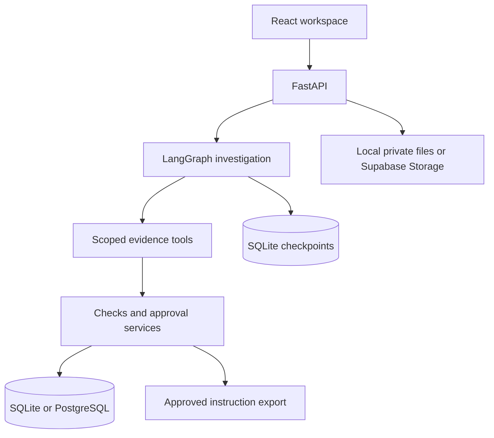

# Architecture

[Documentation](index.md) · [Getting Started](getting-started.md) · [Repository README](../README.md)

## Current Implementation

| Concern | Implementation |
|---|---|
| Database | SQLAlchemy models (`backend/app/models.py`) with SQLite by default; `DATABASE_URL` switches to Supabase PostgreSQL. The equivalent DDL is in `backend/supabase/migrations/0001_initial.sql` (generated by `scripts/export_schema.py`). |
| Authentication | HS256 JWT verification compatible with Supabase Auth claims (`sub`, `email`, `aud=authenticated`). A development login endpoint issues tokens for seeded users; disable it with `DEV_LOGIN_ENABLED=false`. Access always requires an organization membership and role check in the API. |
| Files | Private storage keyed by tenant with HMAC-signed, short-lived download tokens. `STORAGE_BACKEND=local` writes under `backend/data/storage`; `STORAGE_BACKEND=supabase` uses a private Supabase Storage bucket through the service role key. |
| Agent execution | LangGraph `StateGraph` with a SQLite checkpointer. `await_approval` interrupts the graph; the human decision resumes it, and the resumed node re-reads the database before reporting. `AGENT_RUN_MODE=inline` runs in the API process; `AGENT_RUN_MODE=worker` queues runs for `python -m app.worker`. |
| Model use | Optional. With `OPENAI_API_KEY` set, the agent drafts clarifications, proposes line matches and missing fields (each proposal is validated against the page text before it is stored), and writes the summary through a bounded tool-calling loop. Without a key the same nodes use deterministic templates, which is also the evaluation baseline. |
| Live updates | The React workspace polls the API for case, run, and queue changes. Supabase Realtime subscriptions are not wired yet. |

## Main Workflow

1. A user creates a case and uploads supporting documents.
2. The system stores immutable document versions and extracts structured fields.
3. The agent retrieves the approved vendor record and relevant purchase documents.
4. Deterministic checks identify arithmetic, identity, duplication, and authorization problems.
5. The agent explains discrepancies and asks for missing evidence or drafts a clarification message.
6. A reviewer resolves exceptions or sends the case back for more information.
7. The system produces an approval snapshot containing the exact amount, currency, beneficiary, evidence versions, and policy version.
8. An authorized human approves or rejects that snapshot.
9. The export service revalidates the snapshot and emits an instruction with an audit reference.

Messages remain drafts in the MVP. Users supply responses and additional documents through the case interface.

## Agent Responsibilities

The implemented graph is in [backend/app/agent/graph.py](../backend/app/agent/graph.py), with scoped tools in [tools.py](../backend/app/agent/tools.py). Application services remain authoritative for monetary checks, membership, beneficiary records, approval freshness, and export. Uploaded content is evidence; it cannot grant permissions.

See [Database](database.md) for snapshot binding and [Product and Design Notes](design-notes.md) for the original target architecture and milestones.

## Design References

- [LangGraph overview](https://docs.langchain.com/oss/python/langgraph/overview)
- [LangGraph persistence](https://docs.langchain.com/oss/python/langgraph/persistence)
- [Supabase Auth](https://supabase.com/docs/guides/auth)
- [Supabase Row Level Security](https://supabase.com/docs/guides/database/postgres/row-level-security)
- [Supabase Realtime](https://supabase.com/docs/guides/realtime)
