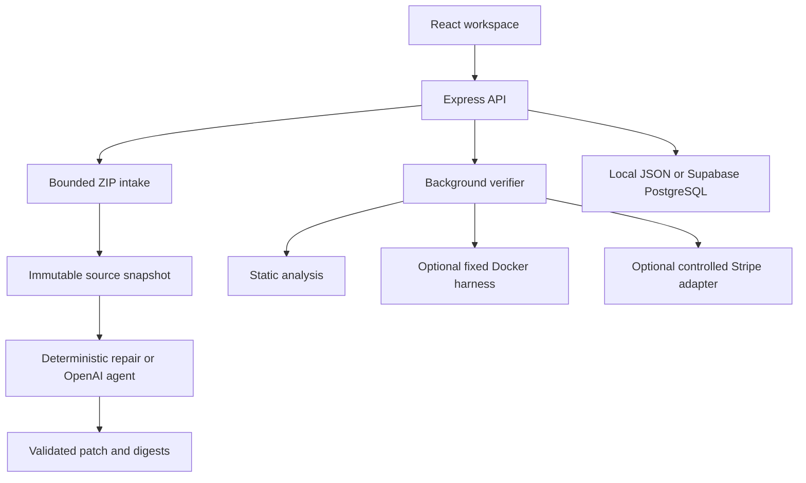

# Architecture

[Documentation](index.md) · [Getting Started](getting-started.md) · [Repository README](../README.md)

## Current Implementation

## Workflow

- Responsive dashboard, project search/filters, run history, documentation, and service settings.
- ZIP intake with traversal, symlink, special-file, duplicate-path, credential-pattern, file-count, and expanded-size validation. Source is read into bounded memory, never extracted to the host.
- Immutable source snapshots, SHA-256 digests, dependency and route inspection.
- Deterministic repair of supported Express JSON/raw-body ordering bugs across paths and route names. Ambiguous layouts are refused.
- Payment module scaffolding with stable idempotency keys, server-owned example prices, asynchronous states, and explicit application-specific decisions. Mounting, ownership, pricing, and durable effects require merchant review.
- Optional single-agent generation using the OpenAI Agents SDK, scoped inspection/docs tools, validated structured output, bounded turns/time, and trace exporting disabled.
- Allowlisted official documentation retrieval with timestamps. Unavailable references remain marked as not retrieved.
- Unified/split diffs, source explorer, patch downloads, JSON evidence reports, background verification, and cancellation.
- Loopback-only local mode, Host/origin checks, custom-header mutation protection, generation limits, and optional Supabase authentication, organization authorization, and persistence.

## Trust and Verification Boundaries

Source intake is bounded and held in memory; uploaded scripts and dependency installation never run on the host. The generation agent uses scoped source-inspection and allowlisted documentation tools. The fixed Docker harness executes the candidate in a constrained container, while the controlled Stripe adapter performs separate sandbox checks.

See [Source Contract](source-contract.md), [Configuration](configuration.md), and [Testing](testing.md) for exact supported inputs, isolation constraints, and evidence labels. Source and patch digests tie each run to its artifact version.
